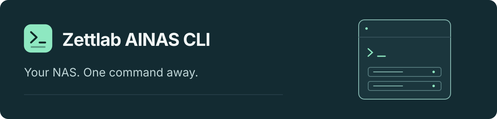
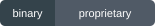

<p align="center">
  
</p>

<h1 align="center">Your NAS, connected to your workflow.</h1>

<p align="center">
  Browse, search, and manage your Zettlab NAS from the terminal or your AI agent.<br>
  One CLI. Your NAS account. The tools you already use.
</p>

<p align="center">
  <a href="https://github.com/zettlab/zettos-ainas-cli/releases"></a>
  <a href="#use-your-ai-agent"></a>
  <a href="docs/en/LOCALIZATION.md"></a>
  <a href="LICENSE"></a>
</p>

<p align="center">
  <strong>English</strong> · <a href="README.zh-CN.md">简体中文</a>
</p>
<p align="center">
  <a href="docs/en/README.md"><strong>Documentation</strong></a> ·
  <a href="docs/en/INSTALL.md">Installation</a> ·
  <a href="https://github.com/zettlab/zettos-ainas-cli/releases">Releases</a> ·
  <a href="SUPPORT.md">Get help</a>
</p>

> [!NOTE]
> **The first public Beta is coming soon.** No binary release is available for download yet. Installation commands below apply once the corresponding version is published. See [platform requirements](docs/en/COMPATIBILITY.md).

##  Work with what's on your NAS

Find a document, locate a photo, check your device, or manage an application without switching between separate tools.

| Capability | What you can do |
| :--- | :--- |
| **Files & search** | Browse personal and shared spaces. Find content with keyword and AI-assisted search. |
| **Questions about your content** | Retrieve relevant NAS context with `znas ask` for your agent to turn into an answer. |
| **Device & services** | Read device status and work with settings, applications, and containers. |
| **Photos & workspaces** | Access photo workflows, Coder, Theater, and desktop status through their NAS services. |

Available features depend on your NAS firmware, installed services, storage, and account permissions. [Check feature requirements →](docs/en/COMPATIBILITY.md)

##  Start with three steps

Install on the computer running your terminal or agent. You need **Python 3.9+, curl, and OpenSSL**, plus an initialized Zettlab NAS with an account and configured storage. NAS SSH access and a Rust toolchain are not required.

### 1. Install

After the Beta is published, download and review the script, then install:

```bash
curl --proto '=https' --proto-redir '=https' -fsSL \
  https://raw.githubusercontent.com/zettlab/zettos-ainas-cli/main/install.sh -o install.sh
bash install.sh install --version v0.1.7-beta.1 --agent codex
export PATH="$HOME/.local/bin:$PATH"
znas --version
```

Choose `codex`, `claudecode`, or `openclaw`; use `none` for CLI-only installation. The installer uses your user account without sudo. [All installation options →](docs/en/INSTALL.md)

### 2. Connect your NAS

Use the address you open in your browser to reach the NAS. Replace the placeholders below:

```bash
znas --base-url 'http://<NAS-address>:<port>' auth probe
znas --base-url 'http://<NAS-address>:<port>' auth login \
  --username '<NAS-username>' --keep-logged-in
```

Enter your password at the hidden terminal prompt. Use HTTPS for remote access. [Connection and account guide →](docs/en/QUICKSTART.md)

### 3. Explore

```bash
# Discover your file spaces.
znas file root spaces

# Browse your personal space.
znas file root list --json '{"path":"/personal","size":20,"index":0}'

# Find content or retrieve context for a question.
znas search --query 'cats'
znas ask --question 'Summarize the product launch documents'
```

`search` finds content. `ask` retrieves context; your agent or model generates the conversational answer. AI features require the corresponding NAS services, models, and indexes.

<a id="use-your-ai-agent"></a>

##  Use your AI agent

Install the supplied skills, refresh your agent, and describe the task in your own words.

| Agent | Installer option | Default skills directory |
| :--- | :--- | :--- |
| **Codex** | `--agent codex` | `~/.codex/skills` |
| **Claude Code** | `--agent claudecode` | `~/.claude/skills` |
| **OpenClaw** | `--agent openclaw` | `~/.agents/skills` |
| **Custom** | `--agent custom --skills-dir <path>` | Your chosen directory |

> “List the files in my NAS personal space.”
>
> “Find photos of cats on my NAS.”
>
> “Summarize the product launch documents on my NAS.”

<details>
<summary><strong>Explore the nine included skills</strong></summary>

| Skill | Purpose |
| :--- | :--- |
| [Shared](skills/znas-shared/SKILL.md) | Connection, authentication, and common usage rules |
| [Files](skills/znas-file/SKILL.md) | Browsing, file operations, search, and content retrieval |
| [Settings](skills/znas-settings/SKILL.md) | Device and service settings |
| [App Store](skills/znas-app-store/SKILL.md) | Application workflows |
| [Docker](skills/znas-docker/SKILL.md) | Containers, images, and networks |
| [Photos](skills/znas-photos/SKILL.md) | Photo search, albums, and related workflows |
| [Coder](skills/znas-coder/SKILL.md) | NAS development workspaces and application artifacts |
| [Theater](skills/znas-theater/SKILL.md) | Media libraries and playback workflows |
| [Desktop](skills/znas-desktop-shell/SKILL.md) | Monitor, task, message, and desktop workflows |

</details>

##  Your account. Your permissions.

- **NAS permissions apply.** Commands operate through your NAS account and gateway.
- **Credentials stay out of chat.** Use the hidden password prompt; saved credentials are encrypted locally with restricted file permissions.
- **Downloads are verified.** The installer checks release signatures and file digests before installation.
- **Know what your agent receives.** File names, excerpts, and content read by an agent may reach its model provider. Review [privacy and data flow](docs/en/PRIVACY.md).

For vulnerabilities or credential exposure, use [private security reporting](docs/en/SECURITY.md).

##  Documentation & support

| Looking for | Go to |
| :--- | :--- |
| Install, update, roll back, or uninstall | [Installation guide](docs/en/INSTALL.md) |
| Connect a NAS or manage account aliases | [Quick start](docs/en/QUICKSTART.md) |
| Platform and feature requirements | [Compatibility](docs/en/COMPATIBILITY.md) |
| Fix a connection or usage problem | [Troubleshooting](docs/en/TROUBLESHOOTING.md) |
| Report a problem or request a feature | [Support](SUPPORT.md) |
| Read version changes | [Changelog](docs/en/CHANGELOG.md) |

Documentation is available in **English and Simplified Chinese**. Installer and CLI messages are currently English. [Language support →](docs/en/LOCALIZATION.md)

### Distribution & license

`znas` is distributed as a proprietary binary; its implementation remains private. This repository provides user documentation, installation tools, and agent skills. Binary usage is governed by [LICENSE](LICENSE); public scripts, docs, and skills use [TOOLING-LICENSE](TOOLING-LICENSE). Third-party notices accompany release archives.

---

<p align="center">
  <a href="docs/en/README.md">Read the docs</a> ·
  <a href="https://github.com/zettlab/zettos-ainas-cli/releases">View releases</a> ·
  <a href="SUPPORT.md">Contact support</a>
</p>
