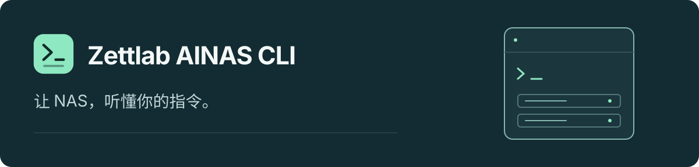

<p align="center">
  
</p>

<h1 align="center">你的 NAS，一个入口。</h1>

<p align="center">
  在终端或 AI Agent 中浏览、搜索和管理你的 Zettlab NAS。<br>
  一套命令行，使用你的 NAS 账号，连接你熟悉的工具。
</p>

<p align="center">
  <a href="https://github.com/zettlab/zettos-ainas-cli/releases"></a>
  <a href="#use-your-ai-agent"></a>
  <a href="docs/LOCALIZATION.md"></a>
  <a href="LICENSE"></a>
</p>

<p align="center">
  <a href="README.md">English</a> · <strong>简体中文</strong>
</p>
<p align="center">
  <a href="docs/README.md"><strong>文档中心</strong></a> ·
  <a href="docs/INSTALL.md">安装指南</a> ·
  <a href="https://github.com/zettlab/zettos-ainas-cli/releases">版本下载</a> ·
  <a href="SUPPORT.zh-CN.md">获取帮助</a>
</p>

> [!NOTE]
> **首个公开 Beta 即将推出，目前尚未开放程序下载。** 以下安装命令在对应版本发布后可用。使用前请查看[平台要求](docs/COMPATIBILITY.md)。

##  从文件到服务，一个入口

找一份文档、搜一张照片、查看设备状态，或管理 NAS 应用，无需在多个工具间切换。

| 能力 | 你可以做什么 |
| :--- | :--- |
| **文件与搜索** | 浏览个人和共享空间，通过关键词与 AI 辅助搜索查找内容。 |
| **围绕内容提问** | 使用 `znas ask` 检索 NAS 中的相关上下文，交给 Agent 生成回答。 |
| **设备与服务** | 查询设备状态，操作设置、应用和容器。 |
| **照片与工作空间** | 通过对应 NAS 服务访问照片、Coder、Theater 和桌面状态。 |

功能可用性取决于 NAS 固件、已安装服务、存储和账号权限。[查看各功能的使用条件 →](docs/COMPATIBILITY.md)

##  三步开始使用

安装在运行终端或 Agent 的电脑上。需要 **Python 3.9+、curl、OpenSSL**，以及已完成初始化、账号与存储设置的 Zettlab NAS。无需开启 NAS SSH，也无需安装 Rust 工具链。

### 1. 安装

Beta 发布后，先下载并查看脚本，再执行安装：

```bash
curl --proto '=https' --proto-redir '=https' -fsSL \
  https://raw.githubusercontent.com/zettlab/zettos-ainas-cli/main/install.sh -o install.sh
bash install.sh install --version v0.1.7-beta.1 --agent codex
export PATH="$HOME/.local/bin:$PATH"
znas --version
```

可选 `codex`、`claudecode` 或 `openclaw`；只使用命令行时选择 `none`。默认安装到当前用户目录，无需 sudo。[查看全部安装选项 →](docs/INSTALL.md)

### 2. 连接 NAS

填写你在浏览器中访问 NAS 时使用的网关地址，并替换以下占位符：

```bash
znas --base-url 'http://<NAS地址>:<端口>' auth probe
znas --base-url 'http://<NAS地址>:<端口>' auth login \
  --username '<NAS用户名>' --keep-logged-in
```

在终端的隐藏提示中输入密码。外网访问请使用 HTTPS。[连接与账号指南 →](docs/QUICKSTART.md)

### 3. 浏览与查找

```bash
# 查看可用文件空间。
znas file root spaces

# 浏览个人空间。
znas file root list --json '{"path":"/personal","size":20,"index":0}'

# 查找内容，或为问题检索上下文。
znas search --query '猫'
znas ask --question '总结 NAS 里的产品发布文档'
```

`search` 用于查找内容；`ask` 返回检索上下文，由 Agent 或模型生成最终回答。AI 功能需要相应 NAS 服务、模型与内容索引。

<a id="use-your-ai-agent"></a>

##  接入你熟悉的 AI Agent

安装随附的 skills，刷新 Agent 后，用自然语言描述你的任务。

| Agent | 安装参数 | 默认 skills 目录 |
| :--- | :--- | :--- |
| **Codex** | `--agent codex` | `~/.codex/skills` |
| **Claude Code** | `--agent claudecode` | `~/.claude/skills` |
| **OpenClaw** | `--agent openclaw` | `~/.agents/skills` |
| **自定义** | `--agent custom --skills-dir <path>` | 你指定的目录 |

> “列出我 NAS 个人空间里的文件。”
>
> “帮我找 NAS 里拍到猫的照片。”
>
> “总结 NAS 里关于产品发布计划的文档。”

<details>
<summary><strong>查看随附的九个 skills</strong></summary>

| Skill | 用途 |
| :--- | :--- |
| [通用规则](skills/znas-shared/SKILL.md) | 连接、认证与共同使用规则 |
| [文件](skills/znas-file/SKILL.md) | 浏览、文件操作、搜索与内容检索 |
| [设置](skills/znas-settings/SKILL.md) | 设备与服务设置 |
| [应用商店](skills/znas-app-store/SKILL.md) | 应用管理流程 |
| [Docker](skills/znas-docker/SKILL.md) | 容器、镜像与网络 |
| [照片](skills/znas-photos/SKILL.md) | 照片搜索、相册及相关功能 |
| [Coder](skills/znas-coder/SKILL.md) | NAS 开发工作空间与应用产物 |
| [Theater](skills/znas-theater/SKILL.md) | 媒体库与播放流程 |
| [桌面](skills/znas-desktop-shell/SKILL.md) | 监控、任务、消息与桌面功能 |

</details>

##  使用你的账号，遵循你的权限

- **沿用 NAS 权限。** 命令通过你的 NAS 账号与网关执行。
- **凭据不进聊天。** 使用隐藏密码提示；登录凭据在本机加密保存，并受文件权限保护。
- **下载经过校验。** 安装器会先验证发布签名和文件摘要，再执行安装。
- **了解 Agent 的数据流。** 文件名、摘要与读取内容可能发送给 Agent 使用的模型服务。请阅读[隐私与数据流说明](PRIVACY.md)。

漏洞和凭据泄露请通过[私密安全报告](SECURITY.md)反馈。

##  文档与支持

| 你想了解 | 对应入口 |
| :--- | :--- |
| 安装、更新、回退或卸载 | [安装指南](docs/INSTALL.md) |
| 连接 NAS 或管理账号别名 | [快速开始](docs/QUICKSTART.md) |
| 平台与功能使用条件 | [兼容性说明](docs/COMPATIBILITY.md) |
| 解决连接或使用问题 | [常见问题](docs/TROUBLESHOOTING.md) |
| 报告问题或提出功能建议 | [支持与反馈](SUPPORT.zh-CN.md) |
| 查看版本变化 | [更新记录](CHANGELOG.md) |

文档提供**简体中文和英文**。安装器与 CLI 提示目前为英文。[语言支持说明 →](docs/LOCALIZATION.md)

### 分发与许可

`znas` 以专有二进制程序分发，实现源码保持私有。本仓库提供用户文档、安装工具和 Agent skills。程序使用遵循 [LICENSE](LICENSE)；公开脚本、文档与 skills 遵循 [TOOLING-LICENSE](TOOLING-LICENSE)。第三方声明随发行包提供。

---

<p align="center">
  <a href="docs/README.md">阅读文档</a> ·
  <a href="https://github.com/zettlab/zettos-ainas-cli/releases">查看版本</a> ·
  <a href="SUPPORT.zh-CN.md">获取支持</a>
</p>
